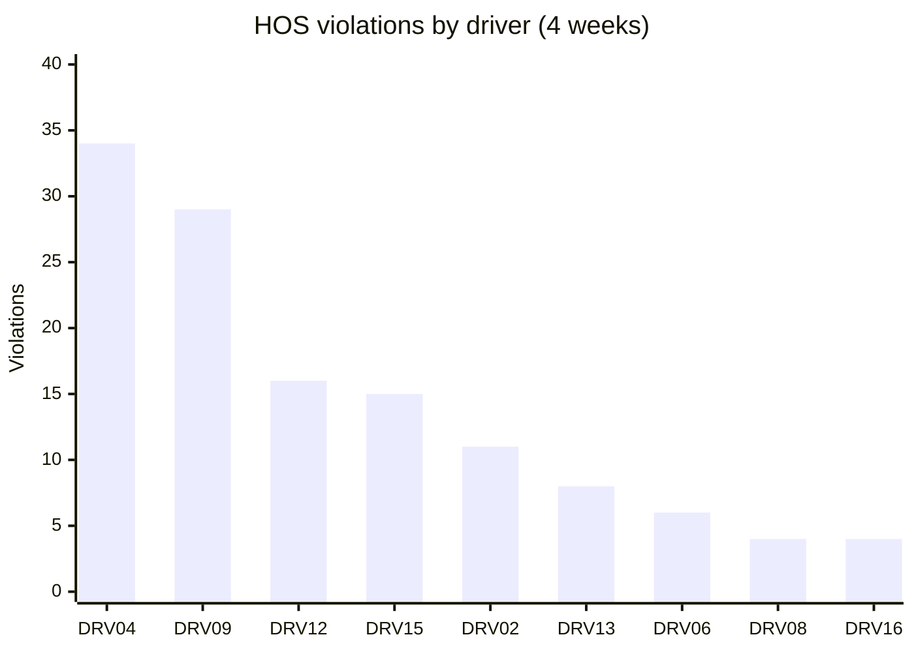

# Hours-of-Service Compliance Checker

**SQL checks that scan electronic logging device (ELD) duty-status logs for violations of Canada's commercial-driver hours-of-service rules, and show which drivers need coaching.**

> **Sample data.** The 20 drivers and 3,637 log entries are **synthetic**. As a former AZ driver (long haul, cross-border and city, 2013–2017), I built this to show how a fleet's safety team could catch violations before an inspection does. It is not legal advice; always check the current regulations.

**Tools:** SQL (SQLite, window functions)

---

## Rules checked

Based on the federal *Commercial Vehicle Drivers Hours of Service Regulations* (SOR/2005-313), south of 60°N:

| Rule | Limit |
|---|---|
| **R1** Daily driving | No more than **13 hours** of driving in a day |
| **R2** Daily on-duty | No more than **14 hours** on duty (driving + on duty) in a day |
| **R3** Cycle 1 | No more than **70 hours** on duty in any **7 consecutive days** |

*Simplifications:* a "day" here is midnight to midnight. The daily 10-hour off-duty minimum is the mirror image of R2 on a calendar-day log, so it isn't counted twice. The 16-hour elapsed work-shift rule, deferral and sleeper-berth splitting aren't checked.

---

## Key results (4 weeks, Oct 6 – Nov 2, 2025)

- **89.6% of driver-days were compliant** with the daily limits (363 of 405 worked days).
- **134 violations** across 13 of 20 drivers; 7 drivers had none.
- **Four drivers account for 70% of all violations** (DRV04, DRV09, DRV12, DRV15).
- **Cycle violations are the most common (69).** The worst 7-day window reached **97.75 hours** on duty, nearly 28 hours over the limit.
- **On-duty limits are broken more often than driving limits** (42 vs 23). In 19 cases the driver stayed under 13 hours of driving but went over 14 hours on duty, because of time spent loading, inspecting or clearing customs.
- **Cross-border drivers have the most violations** (11.5 per driver vs 4.2 for long haul). They average 2.5 hours a day of on-duty, non-driving time (customs, inspections), versus about 1.6 for other drivers.

### Violations by rule

| Rule | Violations | Drivers involved |
|---|---|---|
| R1 Driving > 13 h | 23 | 9 |
| R2 On duty > 14 h | 42 | 11 |
| R3 Cycle 1 > 70 h / 7 days | 69 | 9 |

### Drivers with the most violations

| Driver | Type | R1 | R2 | R3 | Days off (of 28) |
|---|---|---|---|---|---|
| DRV04 | Long haul | 6 | 8 | 20 | 5 |
| DRV09 | Cross-border | 6 | 10 | 13 | 6 |
| DRV12 | Cross-border | 2 | 5 | 9 | 6 |
| DRV15 | Regional | 3 | 4 | 8 | **2** |

### By driver type

| Driver type | Drivers | Violations | Per driver |
|---|---|---|---|
| Cross-border | 6 | 69 | **11.5** |
| Regional | 2 | 15 | 7.5 |
| Long haul | 12 | 50 | 4.2 |

---

## Recommendations

1. **Coach the four repeat drivers first.** They account for 70% of violations, so fixing their schedules has the biggest effect.
2. **Plan cross-border trips around customs time.** Budget at least 2.5 hours of on-duty, non-driving time when dispatching, so the 14-hour limit isn't hit on the return leg.
3. **Make dispatch watch the 7-day cycle.** Run the daily totals view every morning and stop assigning loads to any driver within 10 hours of the 70-hour limit.
4. **Enforce rest days.** DRV15 had only 2 days off in 28; a rule of at least 1 day off in every 7 should cut cycle violations sharply.

---

## How it works

- **`daily_totals`** (view): driving, on-duty and off-duty hours per driver per day.
- **`violations`** (view): one row per driver, day and rule broken. R3 uses a **7-day rolling window** (`SUM() OVER (... ROWS BETWEEN 6 PRECEDING AND CURRENT ROW)`).
- The summary queries in `sql/01_hos_checks.sql` produce the tables above.

## The data

| Table | Rows | One row = |
|---|---|---|
| `drivers` | 20 | a driver: long haul, regional or cross-border; home terminal |
| `duty_status_log` | 3,637 | one duty-status segment: OFF, SB (sleeper), D (driving) or ON (on duty, not driving), with start and end times |

## How to reproduce

1. Install **[DB Browser for SQLite](https://sqlitebrowser.org/)** (free).
2. Follow the steps at the top of `sql/00_create_database.sql`.
3. Run `sql/01_hos_checks.sql`, one statement at a time (it creates two views first).
